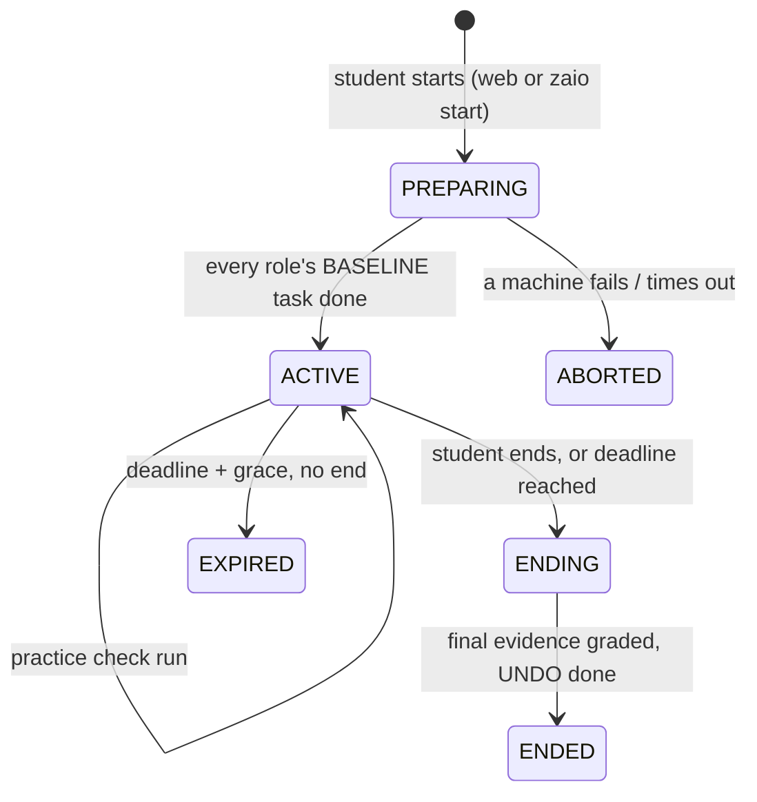

# Athena Labs — machine-graded practicals

Design spec, version 0.2 (supersedes the v0.1 "VM Labs" draft).

Labs are the second kind of Athena scenario, next to the SOC Dojos and
Assessments. A student links one or more of their own machines (VMs) to their
Athena account, starts a lab session, does the work on those machines, and
Athena grades what it finds there. A small Go agent on each machine collects
evidence; **all interpretation and grading happens in Athena**, driven by a lab
definition written in the lab language described in section 9.

---

## 1. Goals and non-goals

**Goals**

- Labs are a first-class scenario kind and reuse the existing machinery: cohort
  release, Dojo/Assessment semantics, `Submission` with commit and release, the
  LMS assessments API, ATT&CK tags, the Autobuilder.
- One language that can grade any tool on the machine, not just nginx or Snort.
  New tools are supported by adding Athena-side parsers, not agent releases.
- Several machines per student, each with a role in a lab.
- Raw evidence is kept, so any lab can be re-graded after a parser or check fix.
- Make cheating **expensive and visible**. Tamper-evident, not tamper-proof.

**Non-goals for now**

- Checks that depend on network topology, IP addressing or traffic between
  machines. (The step model in 9.5 leaves room for them later.)
- Windows or macOS machines. (The agent is Go so this is a port, not a rewrite.)
- Live remote access to student machines. The agent only polls outward.

---

## 2. Principles

| # | Principle | Consequence |
|---|---|---|
| P1 | **The machine is untrusted.** The student has root. | Signatures prove *which* machine sent evidence, not that it is true. Integrity comes from cross-checks and signals (section 13), not crypto. |
| P2 | **The agent collects, Athena interprets.** | The agent knows ~6 primitives (read a file, run a command, …) and returns raw bytes. Parsers and grading live only in Athena. |
| P3 | **Instructions come only from Athena, signed.** | The agent runs commands only from a bundle signed with Athena's key. Commands are argv arrays, never a shell. |
| P4 | **Every session is bracketed.** | A baseline is taken at session start and compared at the end: what changed, when, and whether anything happened that shouldn't have. |
| P5 | **Keep the raw evidence.** | Grading is a pure function of (lab version, evidence, params). Re-grading is always possible. |
| P6 | **Flag, don't auto-fail.** | Cheating signals raise instructor flags. A human decides. |
| P7 | **Labs are tested before students see them.** | An upload is rejected unless reference evidence scores full marks (section 11). |

---

## 3. Concepts

| Term | Meaning |
|---|---|
| **Machine** | A student-owned VM enrolled with the agent. A student can have several. Each has a label ("ubuntu-web", "sensor-1"). |
| **Role** | A slot a lab needs filled, e.g. `web` or `sensor`, with OS requirements. A student assigns one of their machines to each role. |
| **Lab** | A scenario of kind `LAB`: brief + lab definition (`lab.yaml`) + assets. Versioned. |
| **Session** | One bracketed attempt at a lab: start (baseline + lockdown) → work → checks → end (final grade + undo). |
| **Check run** | One evaluation inside a session. Practice checks may run several times; the final check runs at end. |
| **Task** | A unit of work queued for one machine's agent (baseline, collect, undo). Carries a signed bundle. |
| **Bundle** | The signed instructions for one task: what to collect, lifecycle actions, asset hashes. |
| **Evidence** | Raw results of a bundle, signed by the machine. |
| **Parser** | Athena code turning raw text into structured data (`nginx -T` → servers/locations). |
| **Assertion** | A CEL expression over evidence + parsed data that decides a check. |

---

## 4. How Labs fit into Athena

`Scenario` gains a `kind`:

```prisma
enum ScenarioKind { SOC LAB }

model Scenario {
  // existing fields …
  kind  ScenarioKind @default(SOC)
  type  ScenarioType // DOJO | ASSESSMENT — unchanged, applies to both kinds
  lab   Lab?
}
```

`type` keeps its meaning for labs: **Dojo** = practice (results shown
immediately, unlimited sessions), **Assessment** = graded (results hidden until
the instructor releases them; re-do allowed until the instructor commits, as
today).

| Existing feature | Behaviour for labs |
|---|---|
| Cohort release, exposure, hidden | Unchanged. `getStudentScenario` gates lab access. |
| Student home cards, ATT&CK tags | Unchanged; the card's CTA opens the lab workspace. |
| Workspace | New `LabWorkspace`: brief (with the student's params), machine/role picker, session controls, check history, per-check results. |
| `Submission` | Assessment labs: ending a session upserts the student's `Submission` with the lab score as the auto-grade and a link to the session. Commit/release/LMS export work unchanged. |
| Progress | Dojo labs: best score and COMPLETED status on the student card. |
| Autobuilder | Accepts `"kind": "LAB"` folders (section 10). |

---

## 5. Data model

Names follow the existing models. Sketch only — final fields settle during M1–M3.

```prisma
model Machine {                  // a student's enrolled VM
  id             String   @id @default(cuid())      // shown as "m_…"
  userId         String
  label          String                             // student-chosen
  hostname       String                             // set by setup: zaio-<handle>-<NN>
  publicKey      String                             // Ed25519, base64 (raw 32 bytes)
  keyFingerprint String                             // SHA256:… short form for UI
  machineId      String                             // /etc/machine-id
  productUuid    String?                            // DMI product_uuid if readable
  os             String                             // "ubuntu"
  osVersion      String                             // "24.04"
  arch           String                             // amd64 | arm64
  agentVersion   String
  capabilities   String[]                           // primitives/actions this agent supports
  status         MachineStatus @default(ACTIVE)     // ACTIVE | REVOKED
  enrolledAt     DateTime @default(now())
  revokedAt      DateTime?
  lastSeenAt     DateTime?
}

model MachineEnrollCode {
  id        String   @id @default(cuid())
  userId    String
  codeHash  String   @unique                        // sha256(code)
  expiresAt DateTime                                // +10 min
  usedAt    DateTime?
  createdAt DateTime @default(now())
}

model Lab {                      // 1:1 with a LAB scenario
  id          String @id @default(cuid())
  scenarioId  String @unique
  slug        String @unique                        // "p21-web", used by the CLI
  versions    LabVersion[]
}

model LabVersion {               // immutable; sessions pin to one
  id          String   @id @default(cuid())
  labId       String
  version     Int
  zcl         Int                                   // language version, 1
  definition  Json                                  // compiled lab.yaml
  assets      Json                                  // [{name, sha256, size, storageKey}]
  createdAt   DateTime @default(now())
  @@unique([labId, version])
}

model LabParam {                 // stored per student, generated on first view
  labId   String
  userId  String
  values  Json                                      // {token: "K7Q2XM", …}
  @@id([labId, userId])
}

model LabSession {
  id            String   @id @default(cuid())
  labVersionId  String
  userId        String
  status        LabSessionStatus  // PREPARING | ACTIVE | ENDING | ENDED | EXPIRED | ABORTED
  nonce         String
  lockdown      Boolean
  startedAt     DateTime?
  deadlineAt    DateTime?          // time limit or lab close, whichever first
  endedAt       DateTime?
  score         Int?
  maxScore      Int?
  flags         String[]
  machines      LabSessionMachine[]
  checkRuns     LabCheckRun[]
}

model LabSessionMachine {        // role binding + baseline for one machine
  sessionId  String
  role       String
  machineId  String
  baseline   Json?                                  // hashes, log offsets, ssh state, boot id
  @@id([sessionId, role])
}

model LabCheckRun {
  id          String   @id @default(cuid())
  sessionId   String
  final       Boolean
  requestedAt DateTime @default(now())
  completedAt DateTime?
  evidence    Json?                                 // per role, raw (size-capped)
  result      Json?                                 // per check: passed, points, hint, reason
  score       Int?
  graderRev   String?                               // grader/parser version, for re-grades
}

model AgentTask {                // the daemon's queue
  id          String   @id @default(cuid())
  machineId   String
  sessionId   String?
  kind        AgentTaskKind      // BASELINE | COLLECT | UNDO
  bundle      Bytes              // exact signed bytes
  signature   String
  status      AgentTaskStatus    // QUEUED | DELIVERED | DONE | FAILED | EXPIRED
  createdAt   DateTime @default(now())
  expiresAt   DateTime
  deliveredAt DateTime?
  completedAt DateTime?
  checkRunId  String?
}

model AgentRequestNonce {        // replay cache for signed requests (10 min)
  key       String   @id                            // machineId:ts:sig-prefix
  createdAt DateTime @default(now())
}

model LabAuditEvent {            // append-only
  id        String   @id @default(cuid())
  userId    String?
  machineId String?
  sessionId String?
  type      String   // ENROL, REVOKE, SESSION_START, TASK_REJECTED, FLAG, OVERRIDE, REGRADE …
  detail    Json
  ip        String?
  createdAt DateTime @default(now())
}
```

Secrets (env vars, never in the DB):

| Variable | Use |
|---|---|
| `ATHENA_AGENT_SIGNING_KEY` | Ed25519 private key (base64 seed) that signs bundles. Separate from `ATHENA_SETTINGS_KEY`. Whoever holds it can run commands as root on every enrolled machine — keep it out of shared `.env` copies. |
| `ATHENA_AGENT_KEY_ID` | Identifier of that key, e.g. `athena-2026-01`, so it can be rotated. |

Per-student parameters are **stored** (`LabParam`), not derived from a secret:
values can be kept unique within a cohort, rotating secrets can't change them
mid-lab, and copy detection is a lookup.

---

## 6. The agent

**Go, one static binary, `zaio`**, built for linux/amd64 and linux/arm64 (Apple
Silicon students on UTM). It is both the background service and the CLI.

```
zaio setup                    enrol this machine (email + one-time code)
zaio status                   enrolment, roles, active session, last heartbeat
zaio start <lab>              start a session (this machine joins; others are queued)
zaio check <lab>              run a practice check (if the lab allows)
zaio end <lab>                final check, grade, undo lockdown
zaio labs                     labs open to this student
zaio daemon                   run by systemd; polls Athena and executes tasks
```

- **The daemon does all work and holds the key.** The CLI talks to it over a
  root-only Unix socket (`/run/zaio.sock`). If the daemon is down, the CLI runs
  the same code in-process.
- **Polling, outbound only.** `GET /api/agent/tasks?wait=25` (long poll). The poll
  doubles as the heartbeat. Works behind VirtualBox NAT; no inbound ports.
- **Capabilities.** The agent reports the primitives and actions it supports at
  enrolment and on every poll. Athena won't start a session on a machine that
  lacks a capability the lab needs (`upgrade_required`).

Files on the machine:

| Path | Mode | Contents |
|---|---|---|
| `/usr/bin/zaio` | 0755 | The binary (pinned Athena public key embedded) |
| `/etc/zaio/agent.json` | 0644 | Athena base URL, machine ID, enrolment time |
| `/etc/zaio/machine.key` | 0600 | Machine Ed25519 private key |
| `/var/lib/zaio/` | 0700 | Session state, undo journal, downloaded assets |
| `/var/log/zaio/agent.log` | 0640 | Local log (no evidence bodies) |
| `/lib/systemd/system/zaio.service` | 0644 | Daemon unit |

Packaging: GoReleaser + nfpm produce `zaio_<ver>_amd64.deb` and `_arm64.deb`,
served from Athena at `/agent/`. A signed apt repository comes later.

---

## 7. Enrolment and request signing

### 7.1 Flow

1. In Athena → **Machines**, the student clicks *Add a machine* and gets
   `K7Q2-9XMP` (8 chars, unambiguous base32, 10 minutes, single use; only the
   sha256 is stored).
2. On the VM: `sudo apt install ./zaio_0.1.0_amd64.deb && sudo zaio setup`,
   entering their Athena email, the code, and a label.
3. The agent generates an Ed25519 key, calls `POST /api/agent/enroll`, writes
   `agent.json`, sets the hostname Athena returns, enables `zaio.service`, and
   prints the machine ID and key fingerprint (also shown in Athena).

Enrol request (the code is the credential; no signature yet):

```json
{
  "email": "student@example.com",
  "code": "K7Q2-9XMP",
  "label": "ubuntu-web",
  "publicKey": "base64 raw 32 bytes",
  "machineId": "71b37a67899c4fa18c536c9cafd37dd8",
  "productUuid": "a3b1…",
  "os": "ubuntu", "osVersion": "24.04", "arch": "amd64",
  "agentVersion": "0.1.0",
  "capabilities": ["file", "glob", "run", "service", "package", "log", "baseline", "ssh_lockdown"]
}
```

Response `201`: `{ "machineId": "m_…", "hostname": "zaio-tmatanda-02", "keyFingerprint": "SHA256:…", "athenaKeyId": "athena-2026-01" }`.

Errors: `400 bad_request`, `401 invalid_code` (wrong, expired, used, or for a
different email — one answer for all), `429 rate_limited` (5 failures per user
and 20 per IP per hour).

A machine whose `machineId` or `productUuid` is already enrolled for **another**
student enrols, but raises `MACHINE_SHARED`. Re-enrolling the same machine for
the same student revokes the old record.

### 7.2 Signed requests

Every call after enrolment carries:

| Header | Value |
|---|---|
| `X-Zaio-Machine` | machine ID |
| `X-Zaio-Ts` | Unix seconds |
| `X-Zaio-Sig` | base64 Ed25519 signature |

Signed string, `\n`-separated: `METHOD`, path with query, `X-Zaio-Ts`, hex
sha256 of the raw body (of `""` if none). Athena checks: machine `ACTIVE`,
timestamp within ±300 s, valid signature, `(machine, ts, sig)` not in the replay
cache (`AgentRequestNonce`, 10 minutes, in Postgres so it survives restarts).

### 7.3 Signed bundles

Bundles are signed over their **exact bytes**, not a canonical re-encoding:

```json
{ "taskId": "t_…", "bundle": "<base64 of the UTF-8 JSON bytes>", "sig": "<base64 Ed25519>", "keyId": "athena-2026-01" }
```

The agent verifies `sig` against the embedded public key for `keyId`, then
parses the decoded bytes. Nothing is ever re-serialized for verification, so Go
and TypeScript never have to agree on JSON formatting. The bundle also embeds
`machineId`, `sessionId`, `taskId` and `expiresAt`; the agent refuses a bundle
for another machine or past its expiry.

---

## 8. Sessions

### 8.1 Lifecycle



1. **Start.** The student picks a machine for each role (Athena remembers the
   last choice) and starts — in the web UI or with `zaio start <lab>` on any of
   those machines. Athena checks: lab open, re-do rules, capabilities, no other
   active session for this lab. It creates the session and one `BASELINE` task
   per machine.
2. **Baseline.** Each agent records: hashes (not contents) of the paths the lab
   declares, sizes/inodes of watched logs (`auth.log`, `wtmp`, lab logs), the
   package list hash, SSH state, boot ID, clock. If the lab has `lockdown`, the
   agent applies it now and writes an undo journal. It also arms a **safety
   undo** (daemon timer + systemd timer) for `deadlineAt + 30 min`, so lockdown
   is undone even if the student never ends the session or Athena is
   unreachable.
3. **Work.** The student works on the machines.
4. **Practice checks** (if `checks.practice` allows): a `COLLECT` task per
   machine, graded, results shown — for Dojos always, for Assessments only if
   the lab says so.
5. **End** (student action, or the deadline): final `COLLECT` → grade →
   `UNDO`. The student's work is never touched; undo only reverts what the
   agent itself changed.

### 8.2 Policy

The `session` section of `lab.yaml` (lockdown itself is under `lifecycle`, 9.3):

```yaml
session:
  timeLimitMinutes: 180        # optional; deadline = min(start + limit, lab close)
  checks:
    practice: true             # allow zaio check during the session
    maxPractice: 20
    cooldownSeconds: 60
    showResults: dojo          # dojo (Dojo labs only) | always | never
```

Lab open/close comes from the cohort binding's release and due dates, exactly as
for SOC scenarios.

---

## 9. The lab language (ZCL v1)

A lab definition is one YAML file, `lab/lab.yaml`, compiled by the Autobuilder
into `LabVersion.definition`. It has seven sections:

```yaml
zcl: 1
session:    # time limit, practice-check policy (8.2)
machines:   # which roles the lab needs
params:     # per-student values
lifecycle:  # what happens at start/end besides the baseline
collect:    # what the agents gather (sent to machines, signed)
parse:      # how Athena structures the raw evidence   (never sent)
checks:     # what Athena asserts, for how many points  (never sent)
```

Only `collect` (rendered) and `lifecycle` (rendered) ever leave Athena.

### 9.1 `machines`

```yaml
machines:
  web:
    os: ubuntu
    versions: ["22.04", "24.04"]
    packages: [nginx, snort]        # warn at start if missing (not a failure)
```

### 9.2 `params`

```yaml
params:
  token:    { type: token, length: 6, alphabet: base32, unique: cohort }
  sid_base: { type: int, min: 1000000, max: 99990000, step: 10000, unique: cohort }
  zone:     { type: choice, values: [alpha, bravo, charlie, delta] }
```

Types: `token`, `int`, `choice`, `word`. `unique: cohort` makes Athena re-draw
until the value is unused in the student's cohort (it tells the author when the
space is too small). Values are generated on first view and stored. They are
available as `{{param.x}}` in the brief and in `collect`, and as `param.x` in
assertions. Every lab should have at least one high-entropy `token` that has to
appear in the student's work — that is what turns similarity into proof.

### 9.3 `lifecycle`

```yaml
lifecycle:
  baseline:
    web:
      hash:  [/etc/nginx/**, /etc/snort/**]       # recorded at start, compared at end
      logs:  [/var/log/nginx/access.log, /var/log/snort/alert]
  lockdown: { ssh: off }                          # applied at start, undone at end
```

Actions in v1 (all journalled and undone at end or by the safety timer):

| Action | Effect |
|---|---|
| `baseline` (always) | Hashes, log offsets, `auth.log`/`wtmp` offsets, package-list hash, SSH state, boot ID |
| `lockdown.ssh: off` | Records state, then stops and **masks** `ssh.socket` and `ssh.service` (Ubuntu 24.04 starts sshd via socket activation) |

Planned for v2: `place` (drop fixture files — broken configs, planted
evidence), `remove`, `service: {start|stop}`. These open up fix-it and forensics
labs; they need the same undo journal.

### 9.4 Collector primitives

The whole agent vocabulary. Each returns `{ "ok": true, … }` or
`{ "ok": false, "error": "not_found|denied|timeout|too_large|unsupported", "message": "…" }`.

| Primitive | Args | Returns |
|---|---|---|
| `file` | `path`, `max_bytes` (default 256 KB) | `exists`, `size`, `mode`, `owner`, `group`, `mtime`, `sha256`, `content` (UTF-8; `content_b64` if binary), `truncated` |
| `glob` | `pattern` (`**` allowed), `content` (bool), `max_files` (200) | `files[]` with the `file` fields |
| `run` | `argv[]`, `timeout` (default 10 s, max 120 s), `stdin`, `cwd` | `exit_code`, `stdout`, `stderr`, `duration_ms`, `timed_out`, `truncated` |
| `service` | `unit` | `load_state`, `active_state`, `sub_state`, `unit_file_state` |
| `package` | `names[]` | `installed{name: version}` |
| `log` | `path` | lines appended **since the session baseline** (by offset; rotation detected by inode), `rotated` |

Rules enforced by the agent regardless of the bundle:

- `run` executes argv directly (no shell), with a scrubbed environment
  (`PATH=/usr/sbin:/usr/bin:/sbin:/bin`, `LANG=C.UTF-8`), stdout/stderr capped
  at 256 KB each.
- Paths are resolved through symlinks before checking. Never readable:
  `/etc/zaio/machine.key`, `/etc/shadow`, `/etc/gshadow`, `/etc/ssh/ssh_host_*_key`,
  `*/.ssh/id_*`, `/root/.ssh/**`. (Defence in depth — a signed bundle could
  `run` anything anyway; this protects the student's secrets from a mistaken lab.)
- Total evidence per task ≤ 2 MB; per-task wall clock ≤ 5 min.

Every collected file result is **augmented by Athena** with `changed` (hash
differs from baseline), `baseline_sha256` and `existed_at_start`, so assertions
can ask whether work happened during the session.

### 9.5 `collect`: steps

`collect` is an ordered list of steps. Each step runs on one role and gathers
named items. Names are global within the lab (so assertions don't repeat the
role).

```yaml
collect:
  - on: web
    gather:
      nginx_test:  { run: [nginx, -t] }
      nginx_dump:  { run: [nginx, -T] }
      nginx_svc:   { service: nginx.service }
      local_rules: { file: /etc/snort/rules/local.rules }
      snort_conf:  { file: /etc/snort/snort.conf }
  - on: web
    gather:
      snort_test:  { run: [snort, -T, -q, -c, /etc/snort/snort.conf], timeout: 60 }
      replay:      { run: [snort, -q, -r, "{{asset.sqli_pcap}}", -c, /etc/snort/snort.conf, -A, console, -k, none], timeout: 60 }
```

- Steps for the same machine run in order, items within a step in order.
- `{{param.x}}`, `{{asset.name}}` (local path of a downloaded, hash-checked
  asset), `{{session.nonce}}` and `{{machine.<role>.hostname}}` are rendered by
  Athena before signing.
- `when: final` / `when: practice` limits a step to final or practice runs
  (e.g. an expensive replay only at the end).
- v1 sends all of a machine's steps in one bundle. Cross-machine ordering
  (step 2 on `attacker` only after step 1 on `sensor`) is a v2 feature: Athena
  will split bundles at role changes and wait between them. The syntax above
  already expresses it.

### 9.6 `parse`

```yaml
parse:
  nginx:  { from: nginx_dump.stdout, with: nginx }
  rules:  { from: local_rules.content, with: snort_rules }
  alerts: { from: replay.stdout, with: regex,
            pattern: '\[\*\*\] \[(?<gid>\d+):(?<sid>\d+):(?<rev>\d+)\] (?<msg>.*?) \[\*\*\]' }
```

The parser registry (Athena, `src/lib/labs/parsers/`):

| Kind | Parsers |
|---|---|
| Generic (v1) | `lines`, `kv` (`sep`, `comment`), `ini`, `json`, `jsonl`, `yaml`, `csv`, `table` (whitespace columns with a header row), `regex` (named groups → one record per match) |
| Specific (v1) | `nginx` (`-T` output → `files[]`, `http`, `servers[]` with `listen`, `server_name`, `directives`, `locations[]`), `snort_rules` (→ `action`, `proto`, `src`, `dst`, `msg`, `sid`, `rev`, `contents[]`, `options{}`), `sshd` (`sshd -T` → map) |
| Later | `apache`, `iptables_save`, `nft`, `auditd_rules`, `suricata_yaml`, `sysctl`, … |

A parser is a module `{ name, version, parse(text, opts) → JSON }`. Its version
is part of `LabCheckRun.graderRev`. If parsing fails, the parsed value is
`{ "error": "…" }` and assertions that use it fail with that reason.

### 9.7 `checks`

```yaml
checks:
  - id: nginx_ok
    title: nginx config is valid and running
    points: 10
    assert:
      - nginx_test.exit_code == 0
      - nginx_svc.active_state == "active"
    hint: nginx must pass its own config test and be running.

  - id: tokens_off
    title: Server header hides the nginx version
    points: 5
    assert: nginx.http.directives.exists(d, d.name == "server_tokens" && d.args == ["off"])
    hint: Look at what the Server header gives away.

  - id: sqli_rule
    title: Snort detects the SQL injection in the capture
    assert:
      - { expr: 'snort_test.exit_code == 0', points: 5, label: Snort loads your config }
      - { expr: 'rules.exists(r, r.action == "alert" && r.msg.contains(param.token))', points: 5, label: Rule carries your token }
      - { expr: 'alerts.exists(a, int(a.sid) >= param.sid_base && int(a.sid) < param.sid_base + 10000)', points: 10, label: Rule fires on the capture }
    hint: Replay your rule against traffic like the brief describes.

  - id: rules_written_in_session
    title: Rules were written during the session
    flag: CHANGED_BEFORE_START
    assert: local_rules.changed
    visibility: instructor
```

Semantics:

- `assert` is one CEL expression or a list. A plain list is all-or-nothing for
  `points`. A list of `{expr, points, label}` scores each item (partial credit);
  the check's total is the sum.
- `when: <CEL>` — the check is skipped (not scored) unless true.
- `flag: CODE` — instead of scoring, raises an instructor flag when the
  assertion is **false**.
- `visibility: student | instructor` — instructor-only checks aren't listed to
  the student (unannounced checks).
- If an expression references a collected item whose `ok` is false, the check
  fails with a reason like `local_rules: not found (/etc/snort/rules/local.rules)`.
  Reasons never include expected values.
- Hints show only on failure, and only when results are visible.

**CEL environment** (`@marcbachmann/cel-js`): every `gather` name and `parse`
name is a variable; plus `param`, `session` (`startedAt`, `nonce`), and
`machine.<role>` (`hostname`, `osVersion`). Extra functions: `cidrContains`,
`semverGte`, `lines(s)`, `count(s, sub)`, `sha256(s)`. CEL always terminates
and has no side effects, so lab authors can't hang or break the grader.

---

## 10. Lab folders and the Autobuilder

```
lab-p21-web/
  scenario.json          { "kind": "LAB", "type": "ASSESSMENT", "title": …, "slug": "p21-web",
                           "techniques": [...], "brief": "brief.md", "lab": "lab/lab.yaml" }
  brief.md               may use {{param.x}} and {{machine.web.hostname}}
  lab/
    lab.yaml
    assets/sqli.pcap
  reference/
    good.evidence.json   must score full marks
    broken.evidence.json optional: must fail the checks listed in broken.expect.json
  instructor/            answer key, notes — ignored by the upload
```

Re-uploading a folder with the same `slug` creates a **new `LabVersion`**;
running sessions keep their version.

---

## 11. Compiler rules and authoring loop

The compiler rejects a lab if:

- `zcl` is unknown, or YAML/shape is invalid (with line numbers);
- a primitive or lifecycle action isn't in the current agent capability list;
- a `gather` name is duplicated, or a `parse.from` / CEL identifier refers to
  an unknown name;
- a CEL expression doesn't compile;
- a `{{param.x}}` / `{{asset.x}}` is undefined, or an asset file is missing;
- a role in `collect` isn't declared in `machines`;
- scored points don't sum to a positive total;
- a hint contains `{{` (hints must not reveal per-student values);
- a `unique: cohort` param space is smaller than 4× the largest cohort.

Then it **grades `reference/good.evidence.json`** (with a fixed test student's
params) and refuses the upload unless it scores full marks, and grades
`broken.evidence.json` against `broken.expect.json` if present.

**Check editor (in Athena).** For a lab version, an architect can open any
stored evidence (a reference file or a real session), edit `lab.yaml`
side by side, and see each assertion's result and each parser's output live. A
"Save as reference" button stores a real session's evidence as the lab's
`good.evidence.json`. This is how labs get written without engineering help:
build a reference VM from the answer key, run a session on it, write checks
against what it captured.

---

## 12. Grading, results and re-grading

- Grading is a pure function: `grade(definition, evidence, params, baseline) → result`.
  It runs in the request that receives the last machine's evidence.
- Per-check results: `passed`, `points`, `max`, `items[]` (for partial credit),
  `hint`, `reason`. The student sees them per `showResults`.
- Assessment labs: `end` upserts the `Submission` (status `SUBMITTED`, lab score
  as the auto-grade suggestion in the grading queue). The instructor commits and
  releases as for SOC assessments. A new session before commit replaces it.
- **Re-grade**: an instructor can re-grade one session or all sessions of a lab
  version with the current parsers (`graderRev` recorded), and see a diff of
  score changes before applying.
- **Override**: per check or total, with a reason, audited.

---

## 13. Cheating signals (flags, not verdicts)

| Flag | Signal |
|---|---|
| `CHANGED_BEFORE_START` | A passing config's final hash equals its baseline hash — the solution was there before the session started. |
| `FAST_COMPLETION` | Full marks implausibly soon after start (threshold per lab, default 10 % of the time limit). |
| `SSH_DURING_LOCKDOWN` | `auth.log`/`wtmp` show SSH logins after the baseline, or SSH found active at end. |
| `LOCKDOWN_TAMPERED` | ssh units unmasked during the session (state at end ≠ state applied). |
| `FOREIGN_TOKEN` | Evidence contains another student's `token` (strong signal: copied work). |
| `CONFIG_SIMILAR` | After removing param values, comments-and-all similarity of changed files with another student's above threshold (computed at end, cohort-wide). |
| `MACHINE_SHARED` | `machineId`/`productUuid` enrolled by another student. |
| `REBOOT_DURING_SESSION` / `HEARTBEAT_GAP` | Boot ID changed / agent silent > 10 min during an active session. Informational. |
| `CLOCK_SKEW` | Machine clock off by > 5 min from Athena. |

Rejected outright (task `FAILED`, audit `TASK_REJECTED`): bad signature, wrong
machine, expired task, session not active, evidence over size limits.

---

## 14. API

Agent API (`/api/agent/*`, signed per 7.2 except enrol):

| Method | Path | Purpose |
|---|---|---|
| POST | `/api/agent/enroll` | Enrol (code is the credential) |
| GET | `/api/agent/me` | Machine status, labs open to the owner |
| GET | `/api/agent/tasks?wait=25` | Long poll + heartbeat; returns queued tasks (signed bundles) |
| POST | `/api/agent/tasks/{id}/result` | Submit evidence / baseline / undo result |
| GET | `/api/agent/assets/{sha256}` | Download an asset referenced by a bundle |
| POST | `/api/agent/sessions` | `zaio start <lab>` — start a session from the machine |
| POST | `/api/agent/sessions/{id}/check` | `zaio check` |
| POST | `/api/agent/sessions/{id}/end` | `zaio end` |

Web side uses Server Actions (session auth), like the rest of Athena: enrol
codes, machine list/rename/revoke, role assignment, session start/check/end,
results. Instructor actions: revoke machine, abort/reset session, re-grade,
override, CSV export.

Errors: `{ "error": "snake_case_code", "message": "…", "retryAfter": 60 }`.

---

## 15. Repository layout

```
agent/                         Go module (zaio)
  cmd/zaio/                    main: CLI + daemon
  internal/client/             HTTP, request signing, long poll
  internal/bundle/             verify + parse bundles
  internal/collect/            file, glob, run, service, package, log
  internal/lifecycle/          baseline, ssh lockdown, undo journal, safety timer
  internal/daemon/             task loop, unix socket
  packaging/                   nfpm/goreleaser config, zaio.service, postinst
protocol/
  schema/                      JSON Schemas: bundle, evidence, task, enroll
  fixtures/                    test keys, signed bundles, evidence samples
                               (Go tests and Athena tests both run against these)
src/lib/labs/                  compiler, params, parsers/, grader (CEL), signing, agent auth
src/app/api/agent/             agent API routes
src/components/screens/labs/   LabWorkspace, Machines, check editor, instructor views
docs/labs/                     this spec, authoring guide, student install guide
```

---

## 16. Milestones

Each milestone ends with tsc, eslint, `next build`, `go test ./...`, and a run
against a real agent in WSL Ubuntu 24.04 (VirtualBox for M6).

| # | Milestone | Done when |
|---|---|---|
| M1 | **Protocol + machines** — schemas, fixtures, `Machine` + enrol codes, Machines page, `/api/agent/enroll`, signed-request verification, agent `setup`/`status`/`daemon` heartbeat | WSL agent enrols against local Athena and shows as online |
| M2 | **Language + grader** — `lab.yaml` compiler, params, generic + nginx/snort/sshd parsers, CEL grader, `kind: LAB` in the Autobuilder, reference gate | The p21 lab uploads; good evidence scores 100, broken evidence fails as expected — no agent involved |
| M3 | **Sessions** — tasks, bundles, baseline, collectors, evidence intake, grading, LabWorkspace, Submission mapping | Full start → check → end on WSL with real nginx + Snort |
| M4 | **Lockdown + packaging** — ssh lockdown, undo journal, safety timer, `.deb` (amd64/arm64), install docs | Lockdown applied and reliably undone, including when the session is abandoned |
| M5 | **Instructor tools** — sessions view, flags, re-grade with diff, overrides, CSV, check editor | An instructor can write and fix checks in the browser |
| M6 | **Pilot** — reference VM (must score 100), broken VM, small student group on VirtualBox | Pilot cohort runs without engineering help |

---

## 17. Decisions taken in this version

| Decision | Choice |
|---|---|
| Agent language | Go, single binary, daemon + CLI |
| Assertion language | CEL via `@marcbachmann/cel-js` (spiked: nested `exists`, `filter`, `in`, `matches`, custom functions all work) |
| Lab file format | YAML (`yaml` package), compiled to JSON |
| Bundle signing | Ed25519 over exact bytes; key ID for rotation |
| Params | Stored per student; `unique: cohort` option |
| First tools | nginx 1.24 and Snort 2.9.20 (Ubuntu 24.04 packages); Suricata 7 later |
| Network checks | Out of scope for v1 |
| Seeding machines (`place`) | Designed, deferred to v2 |
| Results in assessments | Hidden until release by default (`showResults: dojo`) |
| Bundle-signing key (M3) | Generated on first use, stored encrypted in settings (or `ATHENA_AGENT_SIGNING_KEY`). The agent pins the public key from the enrolment response over TLS (re-fetched from `/me` for machines enrolled earlier) rather than having it compiled in, so one agent build works with any Athena |
| Task delivery (M3) | Long poll (≤ 25 s), woken in-process the moment a task is queued; 5 s re-check otherwise. `zaio start/check/end` run their own machine's tasks immediately |
| Baseline coverage (M3) | Every file, glob and log item a role collects is added to its baseline automatically, so `changed` and `log` work without listing paths under `lifecycle.baseline` |
| Student-facing results (M3) | Only partial-credit labels, hints and plain reasons are shown; all-or-nothing assertions (raw expressions) and instructor-only checks never leave the server |
| Lockdown (M4) | `lockdown: { ssh: off }` masks `ssh.socket` + `ssh.service` at the baseline, after writing an undo journal (`/var/lib/zaio/journal`). Undone by: Athena's UNDO task when the session closes in any way, the daemon once `undoAt` (deadline + 45 min) has passed, a transient systemd timer, `zaio undo`, or package removal. Requires `session.timeLimitMinutes`. Existing SSH connections aren't killed (a student may be running `zaio` over one); they are reported instead |
| Lockdown signals (M4) | Every check reports SSH unit states, live SSH sessions and SSH logins since the baseline (auth.log, or the journal without rsyslog) → instructor flags `SSH_DURING_LOCKDOWN` and `LOCKDOWN_TAMPERED` |
| Instructor tools (M5) | Lab page → **Sessions** (every session, flags explained, drawer with results + evaluation notes, raw evidence, lockdown reports, timeline), **score override** (with reason, audited; effective score = override ?? computed, used by students' view, the grading queue and CSV), **Re-grade** (own version or latest, previewed as a diff, recomputed on apply), **Export CSV** (latest per student or all, a column per check), **Check editor** (edit lab.yaml beside reference evidence, a stored student run or an uploaded file; publish = next version after the same gate). Each upload now keeps its lab.yaml and reference evidence for this |
| Packaging (M4) | `npm run agent:build` writes `zaio_<ver>_{amd64,arm64}.deb` with a dependency-free Node .deb writer (`scripts/deb.mjs`); the installer uses the .deb on dpkg systems and the bare binary elsewhere |
